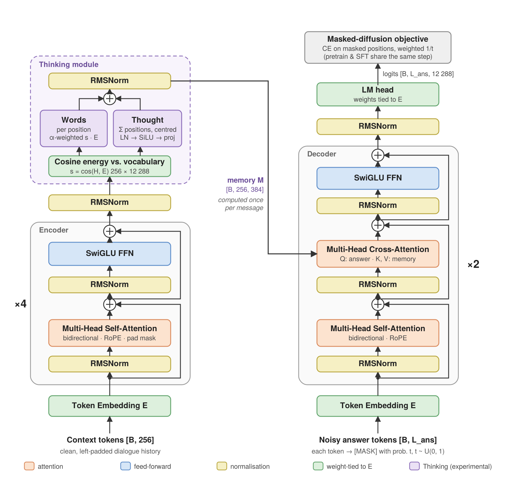

# On-device diffusion chat model


A small conversational language model built from scratch in PyTorch and designed to run fully on-device. Instead of the usual left-to-right decoder, the model is a **masked-diffusion encoder–decoder Transformer**: the dialogue context is encoded once, and the reply is produced by iteratively un-masking a fixed-size answer window.

The project walks through every stage of a production LLM lifecycle at a scale that fits a single free-tier GPU. Two models go through the same pipeline: the main model with an experimental Thinking module, and a parameter-matched baseline without it.

| Stage | What it means here | Thinking model | Baseline |
| --- | --- | --- | --- |
| Data & tokenizer | corpus collection, cleaning, deduplication, byte-level BPE | done | shared |
| Pretraining | masked-diffusion objective on 1.47B tokens of educational web text | done | coming soon |
| Supervised fine-tuning | dialogue data, loss on the assistant turn only | done | coming soon |
| Reinforcement learning | GRPO with rule-based rewards on top of SFT | done | coming soon |
| Benchmarking | zero-shot suites against reference models | done | coming soon |
| Production runtime | export and a C++ inference runtime | coming soon | — |

> Work in progress. Sections marked *coming soon* describe planned work that is not in the code yet.

---

## Architecture



The context and the answer live in two separate windows. The **encoder** reads the clean dialogue history once with bidirectional self-attention. The **decoder** sees the answer slot, in which a random fraction of tokens has been replaced with `[MASK]`, and reads the encoder output through cross-attention. Generation runs the decoder for several steps over the answer slot only, so the cost of a long context is paid once per message rather than once per step. The same split was later found to match the encoder–decoder design of E2D2 [2].

All blocks use the current standard Transformer recipe — pre-norm RMSNorm, SwiGLU feed-forward, rotary position embeddings — with attention assembled by hand from linear projections rather than taken from a library module. Input embeddings, the LM head and the vocabulary projection inside the Thinking module share one weight matrix.

| Property | Value |
| --- | --- |
| Objective | masked (absorbing-state) discrete diffusion, MDLM-style [1] |
| Width / heads | d_model 384, 6 heads × 64 |
| Depth | 4 encoder blocks, 2 decoder blocks |
| Context window | 256 tokens |
| Answer window | 128 tokens (pretraining), 64 tokens (SFT, RL) |
| Vocabulary | 12 288, byte-level BPE, tied embeddings |
| Position encoding | RoPE in self-attention; none in cross-attention |
| Parameters | 19.8M |

### Why diffusion for a phone

The target runtime is a mobile inference engine that works best with a static computation graph. A masked-diffusion model maps naturally onto one: the input is always `[1, L]`, the output is always `[1, L, V]`, and there is no KV-cache to manage between steps. The encoder–decoder split then keeps the per-step cost proportional to the 64-token answer window instead of the full 320-token sequence.

### Thinking module (experimental)

A small module of my own design sits between the encoder and the decoder: it compares each context position with the whole vocabulary through the shared embedding matrix and passes the result on as the decoder's memory. Whether it helps is tested against the baseline without it.

---

## Data

| Split | Source | Size |
| --- | --- | --- |
| Pretraining | FineWeb-Edu, `sample-10BT` | 2.46B train / 12M validation tokens |
| SFT, RL | DailyDialog, EmpatheticDialogues, PersonaChat, MBPP (sanitized), 1 308 synthetic chat and refusal dialogues | 43 732 / 692 / 704 dialogues |

Every source passes through its own adapter into a single schema, then through shared normalisation (`ftfy`, quote and dash unification), filtering, exact deduplication by hash and near-duplicate removal with MinHash LSH. Train / validation / test assignment is deterministic, derived from a hash of the record key, so the split is reproducible and leak-free across re-runs.

The tokenizer is a byte-level BPE with 12 288 entries. The size was chosen by comparing compression at 8k, 12k and 16k: on a phone the output projection is computed at every diffusion step, so vocabulary size has a direct latency cost. Five special tokens (`<pad>`, `<mask>`, `<user>`, `<bot>`, `<eos>`) are used, and sixteen more are reserved for later conditioning. The corpus is stored as `uint16` binary shards; SFT shards carry a parallel mask marking the assistant turns that are allowed to be noised.

## Training

### Pretraining and SFT

Both stages run the same step; only the data differs.

1. Sample a noise level `t ~ U(0, 1)` per example, using a low-discrepancy grid over the batch to reduce the variance of the estimate.
2. Replace each answer token with `[MASK]` independently with probability `t`.
3. Predict the original tokens; cross-entropy is computed on masked positions only and weighted by `1/t`, which gives the diffusion ELBO.

During pretraining a 384-token window from the corpus is split into 256 context tokens for the encoder and 128 continuation tokens for the decoder. During SFT the context is the dialogue history up to the `<bot>` tag and the target is the assistant reply. The loss covers the whole answer slot, padding included, so the model learns to place `<eos>` and choose the reply length itself.

| | Pretraining | SFT |
| --- | --- | --- |
| Initialisation | random | best pretraining checkpoint |
| Steps × batch | 40 000 × 96 | multi-epoch, checkpoint chosen by validation loss |
| Tokens seen | ~1.47B | ~5M per epoch |
| Answer window | 128 | 64 |
| Hardware | 1 × T4, ~8 h | 1 × T4 |

Common setup: AdamW with separate weight-decay groups, linear warm-up followed by cosine decay, fp16 autocast with gradient scaling and clipping, step-based schedule with periodic validation, and checkpoints that separate *initialise from* and *resume from*.

### Reinforcement learning

GRPO-style policy optimisation [4] on top of the SFT model. For every dialogue context the policy samples a group of 8 replies; rewards are normalised within the group, so no value network is needed, and a KL penalty keeps the policy close to the frozen SFT model. A diffusion model has no exact sequence log-likelihood, so it is estimated from the masked-diffusion loss averaged over two noise masks, and the same masks are used for the policy and the reference model to reduce the variance of their difference, following d1 [6] and VRPO [5].

The reward is a set of rules aimed at the defects actually seen in SFT samples:

| Rule | Reward |
| --- | --- |
| Reply length outside the 5–95th percentile of SFT replies for a similar context length | −1 |
| No `<eos>` inside the 64-token window | −1 |
| Reply is one of the 50 most frequent SFT replies ("Thanks.", "Why?", …) | −1 |
| More than half of the reply's trigrams copied from the user turn | −1 |
| Reply starts with punctuation | −0.5 |
| Reply ends a sentence (`.`, `!`, `?`) | +0.5 |
| Repeated trigrams above 20% | −3 × repeat rate |

Setup: 500 steps × 16 contexts × 8 samples, lr 5e-6, KL weight 0.1, one T4, ~25 min. The checkpoint is chosen by mean reward on a fixed set of held-out prompts.

On 32 test dialogues × 4 samples:

| | SFT | RL |
| --- | ---: | ---: |
| Mean reward | −1.15 | **−0.18** |
| Replies without `<eos>` | 38.3% | **15.6%** |
| Mean reply length, tokens | 34.8 | **22.7** |
| Test diffusion loss | **0.91** | 1.15 |

RL removes most run-on and repetitive replies. The higher test loss is the expected cost: the policy moves away from the SFT data distribution towards the rewarded behaviour.

## Sampling

Replies are generated block by block inside the answer window. At each step the decoder predicts every masked position, the most confident predictions are committed, and the rest stay masked for the next step. On top of this I added a training-free remasking rule derived from the G-Star sampler [3]: committed tokens whose confidence falls below the current mean can be returned to `[MASK]`, limited by a per-step budget that decreases over the course of generation. A repetition penalty handles the looping failure mode typical of small diffusion models.

## Benchmarks

Zero-shot, `lm-evaluation-harness` 0.4.13, accuracy %. The harness scores answer options by log-likelihood; for the diffusion model it is computed by un-masking the option left to right inside the 64-token answer slot.

| Model | Params | PIQA | HellaSwag* | ARC-e* | ARC-c* | WinoG | SciQ | LAMBADA | BLiMP |
| :-- | --: | --: | --: | --: | --: | --: | --: | --: | --: |
| ours · SFT | 19.8M | 52.6 | 26.0 | 30.3 | 22.4 | 51.9 | 33.7 | 0.0 | 58.9 |
| ours · RL | 19.8M | 52.8 | 25.8 | 30.7 | 22.2 | 50.0 | 29.5 | 0.0 | 58.5 |
| Pythia-14M | 14M | 56.9 | 26.5 | 32.7 | 21.0 | 51.3 | 50.4 | 10.3 | 67.7 |
| GPT-2 small | 124M | 62.9 | 31.1 | 39.5 | 22.7 | 51.6 | 75.2 | 32.6 | 82.1 |
| *random* | — | 50.0 | 25.0 | 25.0 | 25.0 | 50.0 | 25.0 | 0.0 | 50.0 |

\* length-normalised accuracy. 8.5% of PIQA and 1.7% of HellaSwag options do not fit the 64-token slot and are truncated. The full table, with Pythia-70M and SmolLM2-135M, is in [`sprint3/thinking_module/results.md`](sprint3/thinking_module/results.md).

The model is above chance on ARC-Easy, SciQ and BLiMP and close to chance elsewhere. For scale: Pythia-14M was pretrained on about 300B tokens, this model on 1.47B. RL leaves benchmark scores essentially unchanged, which is expected — it reshapes the form of replies rather than adding knowledge.

---

## Roadmap

### Sprint 1 — Data and tokenizer · done

Corpus collection, cleaning, deduplication, deterministic splits, BPE training, binary sharding.

### Sprint 2 — Pretraining, SFT, RL

Thinking model · done
- [x] Encoder–decoder masked-diffusion model
- [x] Pretraining
- [x] Supervised fine-tuning
- [x] Block-wise sampler with confidence-based remasking
- [x] Reinforcement learning

Baseline without Thinking · *coming soon*
- [ ] Pretraining — same data and schedule, 6 encoder + 2 decoder blocks to match the parameter count
- [ ] Supervised fine-tuning
- [ ] Reinforcement learning

### Sprint 3 — Benchmarking

- [x] Zero-shot evaluation of the Thinking model, SFT and RL checkpoints, against Pythia, GPT-2 and SmolLM2
- [ ] Baseline evaluation on the same suite — *coming soon*
- [ ] Thinking vs. baseline comparison at equal parameters and equal training budget — *coming soon*

### Sprint 4 — Production runtime · coming soon

- Export PyTorch → ONNX → ncnn with numerical parity checks at every stage, as in the earlier [on-device detector](https://github.com/quark28/person-mobile-detector).
- C++ inference runtime: tokenizer, sampler and diffusion loop around the inference engine.
- Chat application on top of the runtime.

---

## Repository layout

```
sprint1/                              data and tokenizer
  data-preprocessing.ipynb            raw source collection, per-source adapters to a unified schema
  data-processing.ipynb               normalisation, filtering, deduplication, deterministic splits
  tokenizer.ipynb                     BPE training, round-trip checks, binary sharding
sprint2/                              training
  thinking_module/
    pretrain.ipynb                    model definition, masked-diffusion pretraining
    sft.ipynb                         supervised fine-tuning, test-set evaluation, sampling
    reinforcement_learning.ipynb      GRPO, rule-based rewards, SFT vs. RL comparison
sprint3/                              evaluation
  thinking_module/
    benchmarks.ipynb                  lm-evaluation-harness wrapper for the diffusion model, baselines
    results.md                        full benchmark tables
docs/                                 architecture diagram and its source
```

All notebooks were run on Kaggle. Model weights and the tokenised corpus are not stored in the repository.

## References

1. Sahoo et al. *Simple and Effective Masked Diffusion Language Models.* NeurIPS 2024.
2. Arriola et al. *Encoder–Decoder Diffusion Language Models for Efficient Training and Inference.* NeurIPS 2025.
3. G-Star remasking sampler. arXiv:2510.08369.
4. Shao et al. *DeepSeekMath: Pushing the Limits of Mathematical Reasoning in Open Language Models.* 2024 (GRPO).
5. Zhu et al. *LLaDA 1.5: Variance-Reduced Preference Optimization for Large Language Diffusion Models.* 2025.
6. Zhao et al. *d1: Scaling Reasoning in Diffusion Large Language Models via Reinforcement Learning.* 2025.
7. Biderman et al. *Pythia: A Suite for Analyzing Large Language Models Across Training and Scaling.* ICML 2023.
8. Su et al. *RoFormer: Enhanced Transformer with Rotary Position Embedding.* 2021.
9. Shazeer. *GLU Variants Improve Transformer.* 2020.
