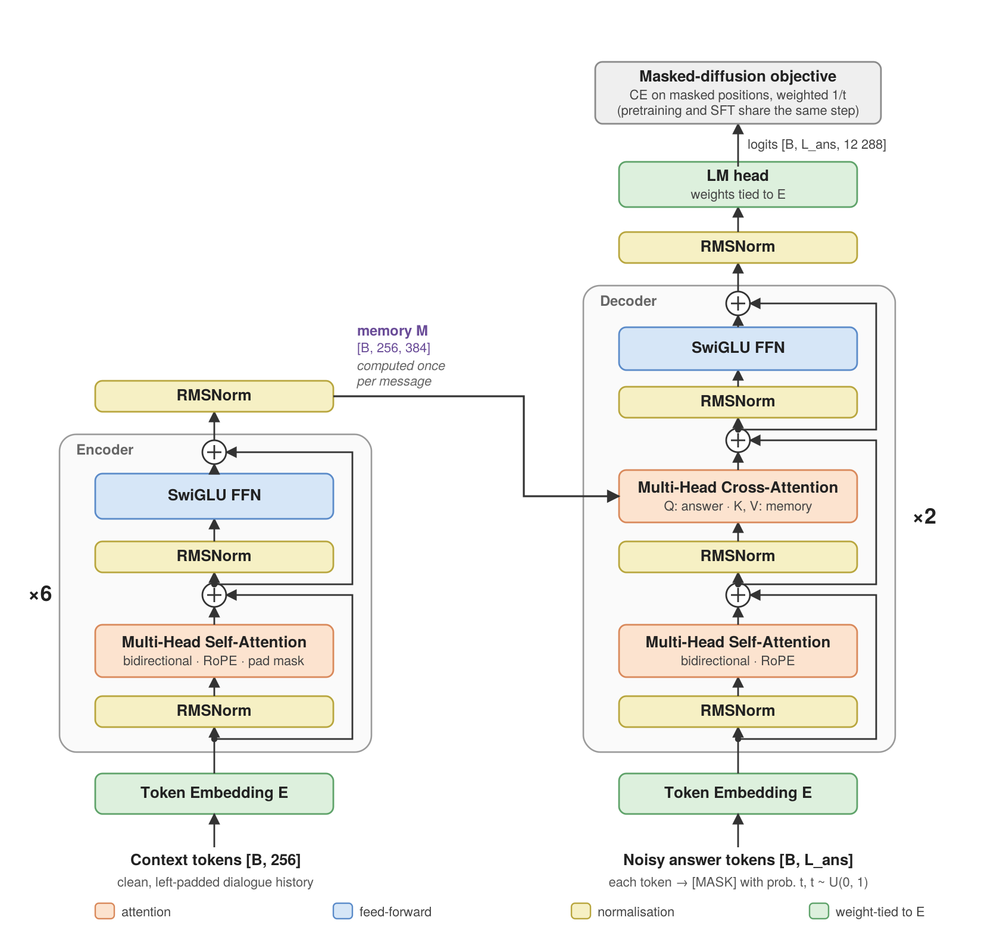

<div align="center">

# mini-llm

**A 20M-parameter masked-diffusion chat model, built from scratch and served by a C++ runtime on a laptop CPU.**

[](https://colab.research.google.com/github/quark28/mini-llm/blob/main/demo.ipynb)
[](https://huggingface.co/quark28/mini-llm-classic-sft)
[](https://huggingface.co/spaces/quark28/mini-llm-chat)
<br>


</div>

Instead of the usual left-to-right decoder, the model is a **masked-diffusion encoder–decoder Transformer**: the dialogue history is encoded once, and the reply is produced by iteratively un-masking a fixed 64-token answer window. Every stage of the LLM lifecycle is implemented here at a scale that fits a single free-tier GPU, from raw datasets to a native inference runtime:

| Stage | What it means here | Code |
| --- | --- | --- |
| Data & tokenizer | 5 sources, cleaning, MinHash deduplication, byte-level BPE | [`sprint1/`](sprint1) |
| Pretraining | masked-diffusion objective on 1.84B tokens of educational web text | [`sprint2/classic/`](sprint2/classic) |
| Supervised fine-tuning | dialogue data, loss on the assistant turn only | [`sprint2/classic/`](sprint2/classic) |
| Reinforcement learning | GRPO with rule-based rewards | [`sprint2/classic/`](sprint2/classic) |
| Benchmarking | 8 zero-shot suites via `lm-evaluation-harness` | [`sprint3/classic/`](sprint3/classic) |
| Export & release | PyTorch → ONNX with generation parity, Hugging Face Hub | [`sprint4/`](sprint4) |
| Native runtime | C++ tokenizer, sampler and console chat on ONNX Runtime | [`sprint5/`](sprint5) |

## Quick start

The fastest way to talk to the model is [`demo.ipynb`](demo.ipynb) (one click via the Colab badge above). It pulls the ONNX graphs, tokenizer and sampler from the [Hugging Face repo](https://huggingface.co/quark28/mini-llm-classic-sft) and opens a chat loop in the notebook.

The C++ runtime shows the reply being un-masked in place, block by block (schematic):

```text
USER: Hello there my dear friend! How are you?
 BOT [1/4]: ░░░░░░░░░░░░░░░
 BOT [1/4]: Hi, I am ░░░░░░░░░░
 BOT [1/4]: Hi, I am good how ░░░ doing?
 BOT: Hi, I am good how are you doing?
```

`[1/4]` is the length candidate currently being decoded; see [Sampling](#sampling).

---

## Model

<p align="center">
  
</p>

The context and the answer live in two separate windows. The **encoder** reads the clean dialogue history once with bidirectional self-attention. The **decoder** sees the answer slot, in which a random fraction of tokens has been replaced with `[MASK]`, and reads the encoder output through cross-attention. Generation runs only the decoder over the answer slot, so the cost of a long context is paid once per message rather than once per step. The same split was later found to match the encoder–decoder design of E2D2.

All blocks follow the current standard recipe: pre-norm RMSNorm, SwiGLU feed-forward, rotary position embeddings. Attention is assembled by hand from linear projections rather than taken from a library module. Input embeddings and the LM head share one weight matrix.

| Property | Value |
| --- | --- |
| Objective | masked (absorbing-state) discrete diffusion, MDLM-style |
| Width / heads | d_model 384, 6 heads × 64 |
| Encoder / decoder blocks | 6 / 2 |
| Context window | 256 tokens |
| Answer window | 128 tokens (pretraining), 64 tokens (SFT, RL, inference) |
| Vocabulary | 12 288, byte-level BPE, tied embeddings |
| Position encoding | RoPE in self-attention, none in cross-attention |
| Parameters | 20.1M |

---

## Data

| Split | Source | Size |
| --- | --- | --- |
| Pretraining | FineWeb-Edu, `sample-10BT` | 2.46B train / 12M validation tokens |
| SFT, RL | DailyDialog, EmpatheticDialogues, PersonaChat (truecased), MBPP (sanitized), 1 308 synthetic chat and refusal dialogues | 43 732 / 692 / 704 dialogues |

Every source passes through its own adapter into a single schema, then through shared normalisation (`ftfy`, quote and dash unification), filtering, exact deduplication by hash and near-duplicate removal with MinHash LSH. Train / validation / test assignment is deterministic, derived from a hash of the record key, so the split is reproducible and leak-free across re-runs.

The tokenizer is a byte-level BPE with 12 288 entries. The size was chosen by comparing compression at 8k, 12k and 16k: the output projection is computed at every diffusion step, so vocabulary size has a direct latency cost. Five special tokens (`<pad>`, `<mask>`, `<user>`, `<bot>`, `<eos>`) are used and sixteen more are reserved. The corpus is stored as `uint16` binary shards; SFT shards carry a parallel mask marking the assistant turns that are allowed to be noised.

## Training

### Pretraining and SFT

Both stages run the same training step; only the data differs.

1. Sample a noise level `t ~ U(0, 1)` per example, using a low-discrepancy grid over the batch to reduce the variance of the estimate.
2. Replace each answer token with `[MASK]` independently with probability `t`.
3. Predict the original tokens; cross-entropy is computed on masked positions only and weighted by `1/t`, which gives the diffusion ELBO.

During pretraining a 384-token window from the corpus is split into 256 context tokens for the encoder and 128 continuation tokens for the decoder. During SFT the context is the dialogue history up to the `<bot>` tag and the target is the assistant reply. The loss covers the whole answer slot, padding included, so the model learns to place `<eos>` and choose the reply length itself.

| | Pretraining | SFT |
| --- | --- | --- |
| Initialisation | random | best pretraining checkpoint |
| Steps × batch | 50 000 × 96 | 20 epochs × 455 steps × 96 |
| Tokens seen | ~1.84B | ~5M per epoch |
| Peak learning rate | 3e-4 | 1e-4 |
| Answer window | 128 | 64 |
| Compute | 1 × T4, ~8.7 h | 1 × T4, ~1.3 h |
| Best validation loss | 4.38 | 0.929 |

Common setup: AdamW with separate weight-decay groups, linear warm-up followed by cosine decay, fp16 autocast with gradient scaling and clipping, step-based schedule with periodic validation, and checkpoints that separate *initialise from* and *resume from*.

### Reinforcement learning

GRPO-style policy optimisation on top of the SFT model. For every dialogue context the policy samples a group of 8 replies; rewards are normalised within the group, so no value network is needed, and a KL penalty keeps the policy close to the frozen SFT model. A diffusion model has no exact sequence log-likelihood, so it is estimated from the masked-diffusion loss averaged over two noise masks, and the same masks are used for the policy and the reference model to reduce the variance of their difference, following d1 and VRPO.

The reward is a set of rules aimed at the defects actually seen in SFT samples:

| Rule | Reward |
| --- | --- |
| Reply length outside the 5–95th percentile of SFT replies for a similar context length | −1 |
| No `<eos>` inside the 64-token window | −1 |
| Reply is one of the 50 most frequent SFT replies ("Thanks.", "Why?", …) | −1 |
| More than half of the reply's trigrams copied from the user turn | −1 |
| Reply starts with punctuation | −0.5 |
| Reply ends a sentence (`.`, `!`, `?`) | +0.5 |
| Repeated trigrams above 20% | −3 × repeat rate |

Setup: 500 steps × 16 contexts × 8 samples, lr 5e-6, KL weight 0.1, one T4, about 30 min. On 32 test dialogues × 4 samples:

| | SFT | RL |
| --- | ---: | ---: |
| Mean reward | −0.67 | **+0.03** |
| Replies without `<eos>` | 17.2% | **7.8%** |
| Mean reply length, tokens | 19.7 | 22.0 |
| Test diffusion loss | **0.92** | 1.04 |

RL removes most run-on and repetitive replies under the simple rollout sampler. With the final sampler, however, the RL policy collapses towards short generic replies, a typical reward-hacking outcome for rule-based rewards. **The released model is therefore the SFT checkpoint.**

## Sampling

The sampler is training-free and built around the model's own confidence:

1. **Length.** One decoder pass over a fully masked slot estimates the expected reply length as Σ(1 − P(`<eos>`) − P(`<pad>`)). Four length candidates are taken at 0.8–1.2× this estimate, and `<eos>` is placed at each.
2. **Block-wise un-masking.** The reply is filled left to right in blocks of 8 tokens. Inside a block, every decoder step commits the single most confident prediction (temperature 0.5, top-k 50).
3. **Remasking.** After each block, and then over the whole reply, a leave-one-out pass re-predicts every committed token with that position masked. A token is replaced when the model now prefers another one by a clear margin (up to two replacements per pass). This is a training-free variant of the G-Star remasking sampler, which uses a separately trained module for the same decision.
4. **Penalties.** Repeated tokens, repeated trigrams inside the reply and 4-grams copied from the user turn are penalised in the logits.
5. **Selection.** Each length candidate is scored by its mean leave-one-out log-probability, and the best one is returned.

## Export and native runtime

The encoder and decoder are exported separately to ONNX (opset 18). With greedy decoding, generation through ONNX Runtime reproduces the PyTorch model token for token on all 10 reference prompts. The weights, ONNX graphs, tokenizer and a Python sampler are published on [Hugging Face](https://huggingface.co/quark28/mini-llm-classic-sft) together with the benchmark results.

[`sprint5/`](sprint5) is a C++20 runtime on top of the ONNX Runtime C++ API, with no Python involved:

- **Tokenizer:** a byte-level BPE reimplementation that loads `tokenizer.json` directly, including the GPT-2 style pre-tokenisation with Unicode category tables.
- **Sampler:** a port of the sampler above, with the leave-one-out pass batched into a single decoder call.
- **Console chat:** live rendering of the un-masking, multi-turn history trimmed to the context window on user-turn boundaries, `reset` and `exit` commands.
- **Parity mode:** `minillm --golden` replays the reference prompts and checks the replies token for token against the PyTorch output. All 10 match.

On a 2019 laptop CPU (Ryzen 5 3500U, 4 threads) a reply takes about 1.5 s with greedy decoding and about 2 s with sampling.

The project is a CMake build for Windows / MSVC. It expects ONNX Runtime 1.31.1 in `sprint5/config/libs/` and the ONNX graphs with `tokenizer.json` in `sprint5/config/models/`.

## Benchmarks

Zero-shot, `lm-evaluation-harness` 0.4.13, accuracy %. The harness scores answer options by log-likelihood; for the diffusion model it is computed by un-masking the option left to right inside the 64-token answer slot.

| Model | Params | Train tokens | PIQA | HellaSwag* | ARC-e* | ARC-c* | WinoG | SciQ | LAMBADA | BLiMP |
| :-- | --: | --: | --: | --: | --: | --: | --: | --: | --: | --: |
| **mini-llm · SFT** | 20.1M | 1.84B | 54.5 | 26.7 | 31.9 | 21.0 | 49.2 | 48.7 | 0.0 | 56.0 |
| mini-llm · RL | 20.1M | 1.84B | 54.8 | 26.8 | 30.0 | 21.6 | 49.6 | 45.6 | 0.3 | 56.2 |
| Pythia-14M | 14M | 300B | 56.9 | 26.5 | 32.7 | 21.0 | 51.3 | 50.4 | 10.3 | 67.7 |
| Pythia-70M | 70M | 300B | 59.8 | 27.4 | 35.2 | 21.8 | 52.9 | 64.0 | 22.7 | 74.2 |
| GPT-2 small | 124M | — | 62.9 | 31.1 | 39.5 | 22.7 | 51.6 | 75.2 | 32.6 | 82.1 |
| SmolLM2-135M | 135M | 2T | 68.4 | 43.1 | 58.6 | 29.6 | 53.0 | 84.0 | 42.9 | 79.0 |
| *random* | — | — | 50.0 | 25.0 | 25.0 | 25.0 | 50.0 | 25.0 | 0.0 | 50.0 |

\* length-normalised accuracy. 8.5% of PIQA and 1.7% of HellaSwag options do not fit the 64-token slot and are truncated. Full tables: [`sprint3/classic/results.md`](sprint3/classic/results.md).

The model is clearly above chance on ARC-Easy, SciQ and BLiMP and close to Pythia-14M on several tasks, with about 160 times fewer training tokens. LAMBADA, which asks for the exact last word of a long passage, is out of reach at this scale. RL leaves the scores essentially unchanged, as expected: it reshapes the form of replies rather than adding knowledge.

---

## Repository layout

```
demo.ipynb                        chat with the released model (ONNX Runtime)
sprint1/                          data and tokenizer
  data-preprocessing.ipynb        raw source collection, per-source adapters to a unified schema
  data-processing.ipynb           normalisation, filtering, deduplication, deterministic splits
  tokenizer.ipynb                 BPE training, round-trip checks, binary sharding
sprint2/classic/                  training
  pretrain-classic.ipynb          model definition, masked-diffusion pretraining
  sft-classic.ipynb               supervised fine-tuning, test-set evaluation, sampling
  rl-classic.ipynb                GRPO, rule-based rewards, SFT vs. RL comparison
sprint3/classic/                  evaluation
  benchmarks-classic.ipynb        lm-evaluation-harness wrapper for diffusion likelihood
  results.md                      full benchmark tables
sprint4/                          release
  classic-sft-onnx-export.ipynb   ONNX export and generation parity check
  huggingface.ipynb               model cards and upload to the Hugging Face Hub
sprint5/                          native runtime
  CMakeLists.txt
  src/                            tokenizer, sampler, ONNX Runtime wrapper, console chat
drafts/                           sampler search and qualitative comparisons
docs/                             architecture diagram and its source
```

The notebooks were run on Kaggle, so data paths point to Kaggle datasets. Model weights and the tokenised corpus are not stored in the repository.

## Inspired by

1. Sahoo et al. *Simple and Effective Masked Diffusion Language Models.* NeurIPS 2024.
2. Nie et al. *Large Language Diffusion Models.* 2025 (LLaDA).
3. Arriola et al. *Encoder–Decoder Diffusion Language Models for Efficient Training and Inference.* NeurIPS 2025 (E2D2).
4. G-Star remasking sampler. arXiv:2510.08369.
5. Shao et al. *DeepSeekMath: Pushing the Limits of Mathematical Reasoning in Open Language Models.* 2024 (GRPO).
6. Zhu et al. *LLaDA 1.5: Variance-Reduced Preference Optimization for Large Language Diffusion Models.* 2025 (VRPO).
7. Zhao et al. *d1: Scaling Reasoning in Diffusion Large Language Models via Reinforcement Learning.* 2025.
8. Su et al. *RoFormer: Enhanced Transformer with Rotary Position Embedding.* 2021.
9. Shazeer. *GLU Variants Improve Transformer.* 2020.
10. Karpathy. [nanoGPT](https://github.com/karpathy/nanoGPT), as a reference for the training loop.

## License

The model weights are released under CC BY-NC-SA 4.0, inherited from the licences of the dialogue datasets used for fine-tuning.

<sub>During development, an attempt was also made to improve quality with an experimental architectural approach.</sub>